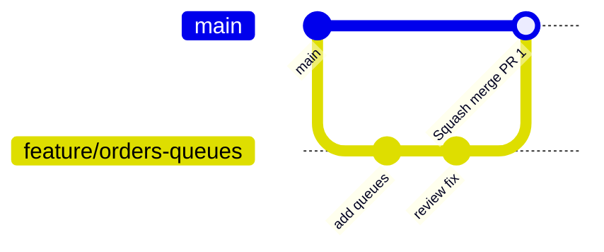
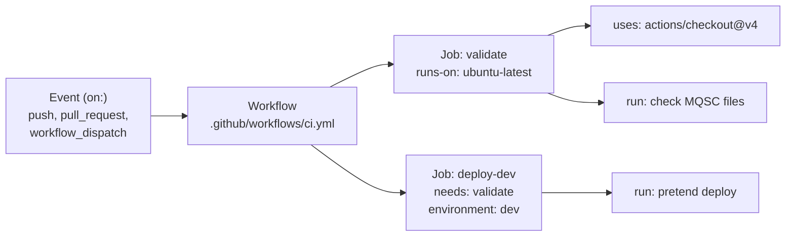

# integration-sandbox

Personal practice repository for learning GitHub and GitHub Actions, built around integration work (IBM MQ, ACE, MQFTE, Kafka / Confluent Cloud).

Nothing in this repository is production code or contains M&S material.

## Goals

- Navigate repositories confidently (code, branches, history, blame, Actions, settings)
- Use the branch, commit, pull request and merge flow on GitHub
- Read and write GitHub Actions workflows
- Review, approve and merge pull requests under branch rules

## Lab checklist

- [ ] Clone this repo with SourceTree or GitHub Desktop
- [ ] Add `mqsc/app.mqsc` on branch `feature/orders-queues`, open a PR, squash and merge
- [ ] Make a second change and merge it with a merge commit, then compare the history
- [ ] Add `.github/workflows/ci.yml` (MQSC validation workflow) via a PR
- [ ] Break the check on purpose (a QLOCAL without DESCR), read the log, fix it
- [ ] Add a ruleset on `main`: require a PR and the `validate` status check
- [ ] Create a `dev` environment with a required reviewer and watch `deploy-dev` wait for approval
- [ ] Run the workflow manually (`workflow_dispatch`)
- [ ] Add `.github/CODEOWNERS` with `/mqsc/  @YOUR-USERNAME`

## Pull request flow

## Workflow anatomy

## Useful links

- [GitHub Skills](https://skills.github.com/)
- [Understanding GitHub Actions](https://docs.github.com/en/actions/get-started/understand-github-actions)
- [Workflow syntax](https://docs.github.com/en/actions/reference/workflows-and-actions/workflow-syntax)
- [Reviewing changes in a pull request](https://docs.github.com/en/pull-requests/how-tos/review-pull-requests)
